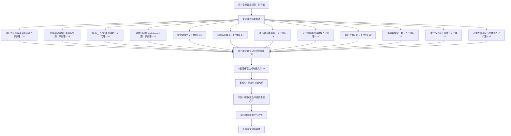
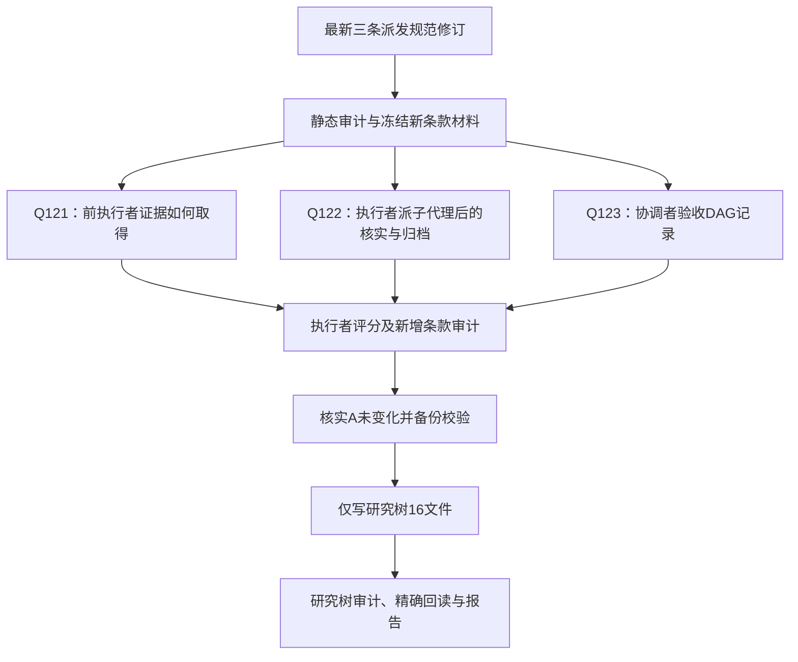

状态：进行中。本任务只修订研究树候选规范；未提交内容归本任务，研究树覆盖尚未执行。

本文件自 2026-10-22 起由协调者维护，协调者是唯一写入者；执行者通过汇报提交进展与计划，由协调者记入。初稿由执行者1在该规则确定前写成。

## 目标与验收标准

- 原用户事项1至16及后续“处理方式”、派发记录和会话权限范围补充一次落实。
- 修正后的B完整13份加3份平台/运行时文件，审计违规数为0，受影响场景复测通过。
- 本任务按 0905 md/development/LOOP.md 第 7、8 行（候选 core/LOOP.core.md 第 34、36 行）属开发/实验任务，因此需要本进度文件：判定依据是本任务新建并运行了非注释的 Python 审计与盲测脚本并做了复测，而不是因为派发或跨会话。
- 本文件由执行者1 在写回时原样复制到研究树任务目录一次；此后协调者只维护研究树中的那份，F:\temp 这份保留为历史工作记录。
- A全部相关文件覆盖前备份并校验哈希，只写研究树允许的16份文件；不add/commit/push、不删目录或工作树。

## 当前缺口

（2026-10-22 更新）修订、审计（0 违规）、复测与评分均已完成：本轮 20 题加 3 道新会话复测；另有 21 道旧题按限定断言复用，旧 Q114 由 Q140 取代，共处置 42 个题号（不把所有题号都称为全新盲测）。评分见 blind-scorecard.md/json，任务8 与基准表 8 行的处置见 review-resolution.md。剩余：执行者1 做最后的逐文件 diff 与写前状态核对，然后备份、写回研究树、复审，再交任务4。0905 与 master 规范始终只读。

## 已完成与证据

- 原20题经必要重测得到符合条款的行为答复；失败实答均保留，尚待最终评分汇总。审计当前版本见 audit-candidate.json，后续新增条款须重新审计。
- A差异逐项处置：A-disposition.md，最终 295 条内容、66 项配置。
- 前7批实际DAG与并发、逐个配置核实和归档：TASK_DAG.md、child-verification.json。前7批是事后补记，原本可提前并行的安排与未及时归档已记偏离。
- 全部15个子代理均已收回结果并归档，实际配置均核实为codex/gpt-6-luna、low、full-access。没有仍运行或需追问而保留的本任务子代理。
- 第8批按本文件事前计划同批派出子代理1-13、1-14、1-15，实际并发3个，含执行者4个。Q121、Q122、Q123场景答复均符合新增条款；配置和归档结果在batch8-verification.json、batch8-archival.json。
- 当前研究分支为 research/agents-core-extraction-20261021-01；输入B只读，A仍未覆盖。所有新工作产物在本目录。

## 下一步

### 剩余全部子任务 DAG（后续派发依据）

| 待派批次 | 同批就绪任务与唯一输出 | 依赖 | 本批并发上限 | 安排 |
| --- | --- | --- | --- | --- |
| 9 | Q124、Q125、Q126；各写新冻结测试目录对应题号结果文件 | R3 | 3个子代理，含执行者4个 | 三题同批派；派前在此记录实际启动，派后逐个核实 |
| 10 | Q127、Q128、Q129；各写对应题号结果文件 | R3、空闲槽位 | 同时最多3个子代理，含执行者4个 | 上批任一任务收回并归档就重评就绪队列；有槽位立即派，不等整批；派前记录实际小批 |
| 11 | Q130、Q131、Q132；各写对应题号结果文件 | R3、空闲槽位 | 同时最多3个子代理，含执行者4个 | 同上，允许按空闲槽位分成有记录的小批 |
| 12 | Q109（复测）、Q134、Q135；各写对应题号结果文件 | R3、空闲槽位 | 同时最多3个子代理，含执行者4个 | 同上 |
| 13 | Q136（子代理1-28，默认 7 个会话及并发计数）、Q137（1-29，按事实判级、L1 多处）、Q138（1-30，协调者实际运行时） | R3、空闲槽位 | 同上 | 同上 |
| 14 | Q139（1-31，删除默认授权与分工）、Q140（1-32，必要用户输入） | R3、空闲槽位 | 同上 | 同上 |
| 15 | Q141（1-33，跨物理树开发并行）、Q142（1-34，非工程对话）、Q143（1-35，获准阶段续接） | R3、空闲槽位 | 同上 | 同上 |

2026-10-22 协调者记入批次 13 至 15（据执行者1 提交的 remaining-plan.md）。R3 已通过：16 份候选审计违规 0（609 处引用），平台占位已全部删除，无机器具体值。批次 9 至 15 均依赖同一冻结版本，彼此无依赖，各写各题号文件；同时最多 3 个子代理（含执行者共 4 个）。全部使用 codex/gpt-6-luna、low、full-access，开启 notifyOnFinish，不传 workspaceId，逐个核实后给真实快照，验收后归档。本任务累计会话不设上限是用户对本任务的例外，候选中的默认值已恢复为 7。执行者1 可以开始派发。

2026-10-22 追加（协调者记入，依据执行者1 汇报）：子代理1-16 至 1-25 已派出，逐个核实为 gpt-6-luna、low、full-access，已验收的随即归档，同时运行不超过 3 个。Q129 初答失败：作答者把“搜索内容即使只计数也须交执行者”的禁令读反，并编造了原文行号；失败答复保留，会话已归档。Q124 引文不是逐字引用，失败初稿保留，退回后删去误引文，场景判断不变；评分中单列。
- 追加节点：当前 20 题全部收回 → 把 core 第 13.2 节同一定义的长段落改写为按动作分项（不改语义，只强化“内容搜索即使只计数也须派执行者”）→ 审计并冻结只含此变化的新快照 → 单题盲测 → 评分。
- 批次 16：Q129 复测，由新的干净会话子代理1-36 作答；唯一输出 blind-search-v2/results/Q129.md；配置同前。依赖上述冻结。协调者已记入，执行者1 可在依赖满足后派发。
- 其余题只复用不受这次排版澄清影响的判定，并写明依据。
- 批次 16 追加（2026-10-22 协调者记入）：Q109 补答仍缺必填的“处理方式”，Q135 把协调者维护的对象误写成归纳笔记、漏了 TASK_LOOP，两份失败稿均保留。可能原因之一（推断，未证实）：子代理读取材料时遇到终端乱码，未固定 UTF-8 输出。为排除这一变量，后续派发把同一 source 文件的逐字 UTF-8 原文（含真实行号，不含答案和评分）直接放进派发消息。新增干净会话：子代理1-37 重测 Q109、子代理1-38 重测 Q135，与 1-36 同批，最多 3 个并行；唯一输出 blind-search-v2/results/Q109.md、Q135.md。依赖：当前 20 题收回、审计冻结、材料投递方式修正。协调者已记入，依赖满足后可派。
- 2026-10-22 结果（协调者记入）：首轮 20 题与批 16 三题全部收回。本轮新子代理 1-16 至 1-38 共 23 个，全部核实为 gpt-6-luna、low、full-access，均已归档，本任务当前无下级在运行。复测：Q129 正确区分了内容计数搜索与元数据核对；Q109 含“任务编号—执行者编号—负责内容”、模型与等待事项；Q135 正确为由协调者维护并转移 TASK_LOOP。失败原稿保留，评分中单列。投递方式：批 9 至 12 为读取文件，批 13 至 16 为内嵌逐字 UTF-8 原文。13.2 节只把原 8 个句子分项重排，句子逐字不变，只有 COLLABORATION 文件哈希变化，其余 15 份逐字未变，审计仍为 0（609 处引用）。下一步由执行者1 做：逐题终评、复用范围表、与 A 的最终对比和逐文件 diff，然后备份、写回、复审，再交任务4。

批次 9 至 12 的会话编号依次为子代理1-16 至 1-27（见 remaining-plan.md）；全部使用 codex/gpt-6-luna、low、full-access，不传 workspaceId，派后逐个核实，验收后归档。协调者已于 2026-10-22 记入本批次计划，执行者1 可在 R3 通过后按此派发；实际拆成的小批由执行者在汇报中报给协调者记入。

R1、R2、R3、R4至R9均由执行者负责，不再委派；R2/R3共享候选写入，R5至R8共享最终文件与研究树，必须串行。原 R1（等待任务2配置值）已取消：平台层不填写机器当前配置值；执行者1 不核查本机配置。R3 已通过；子代理1-1 至 1-38 全部收回并归档，当前没有运行中的子代理。

### 协调者层的任务 DAG（随研究树任务进度文件交接）

| 任务 | 指定负责人及内容 | 依赖与门槛 |
| --- | --- | --- |
| 任务1 | 执行者1：候选修订、受影响复测与写回研究树 | 当前任务 |
| 任务2 | 执行者3：平台默认配置只读核查 | 已取消（2026-10-22 用户决定：平台层只写现有平台与派发规则，不填写机器当前配置值）。执行者3 已停止并归档；中途报告的事实保留在 F:\temp\platform-config-audit-20261022\ 作参考 |
| 任务3 | 执行者4：行为对照题库与基准侧作答 | 已完成（2026-10-22）：28 题，基准侧 90.5/112；7 个作答会话先写 DAG 后派发、逐个核实 gpt-6-luna/low/full-access、已归档。结果在 F:\temp\behavior-compare-20261022\。协调者已验收；执行者4 保留不归档，供任务5 使用 |
| 任务4 | 协调者：验收任务1 | 已完成（2026-10-22 协调者验收通过）。核对了：研究树 16 份规范与本记录已写入，回读 0 差异；研究树审计 0 违规（609 处引用）；评分门禁 0；0905 与 master 的 14 份现行规范前后哈希无变化，0905 工作树干净；子代理 38 个全部归档。执行者1 保留，供任务5 不达标时退回修订 |
| 任务5 | 执行者4：候选侧作答、对比与实测合规检查 | 2026-10-22 已派发。投递方式与基准侧相同（读文件、同一提示模板），不改用内嵌原文；若候选侧出现读取乱码，停下报告，由协调者决定双方是否都改用内嵌原文重答。预算：用户已对本任务（AGENTS.core 拆分）取消子代理累计上限，任务5 按此执行，计划 7 组盲答加 1 个实测会话共 8 个，最多 4 个并发。实测只覆盖执行者层（执行者派发、核实、DAG、归档，子代理在临时派生树完成只读核对加一处文档修正）；协调者层派发链不由执行者冒充测试，单列为未覆盖项。

任务5 下一步（2026-10-22 协调者记入，依据执行者4 的派前记录 F:\temp\behavior-compare-20261022\任务5-DAG与批次.md）：候选 16 份已固定快照、SHA-256 与只读属性；派发前登记 12 题按新规则评分（Q01、Q02、Q03、Q07、Q17、Q18、Q19、Q21、Q22、Q23、Q27、Q28），其余 16 题按“不得低于基准”执行。
| 子任务 | 执行者/子代理 | 内容 | 依赖与批次 |
| --- | --- | --- | --- |
| 任务5-1 | 子代理4-1 | G1 Q01–04 候选侧作答 | 首批，4 个并行 |
| 任务5-2 | 子代理4-2 | G2 Q05–08 | 首批 |
| 任务5-3 | 子代理4-3 | G3 Q09–12 | 首批 |
| 任务5-4 | 子代理4-4 | G4 Q13–16 | 首批 |
| 任务5-5 | 子代理4-5 | G5 Q17–20 | 有空位即补入 |
| 任务5-6 | 子代理4-6 | G6 Q21–24 | 有空位即补入 |
| 任务5-7 | 子代理4-7 | G7 Q25–28 | 有空位即补入 |
| 任务5-8 | 子代理4-8 | 在新建临时派生树中只读查找命名条款，并修正一处说明夹具 | 依赖：临时树已建、夹具与明确改法已就绪、执行者4 的实际设置已核实 |
7 组只写各自的候选侧答案文件；任务5-8 只写指定的临时文档。同时最多 4 个，全部经 Paseo，codex/gpt-6-luna、low、full-access，派后核实，验收后归档。临时树的删除：执行者4 先交检查结果，协调者验收后再派回执行者4 执行，不新建第 9 个会话。协调者已记入，执行者4 可以派发。
- 2026-10-22 编码门禁：首批 4 个作答会话（4-1 至 4-4）读取 0905 规则时报告显示乱码，均已停止，未读候选与题目，未写答案；4 个会话的配置均已核实。经核查，字节按严格 UTF-8 可正常解码，乱码只出在 PowerShell 的显示层。协调者裁决：投递方式不变，作答者读文件时统一显式使用 UTF-8；4-1 至 4-4 补发该指令后继续作答，不新开会话，5-5 至 5-8 同样附上该指令。同时核查任务3 基准侧作答会话是否也出现乱码：出现且可能影响作答的组，用同一指令重答重评；未出现的，基准结果保留。
- 2026-10-22 基准侧核查结果（协调者记入）：G1、G2、G6、G7 的作答会话明确自述遇到乱码；G3、G4、G5 也用 PowerShell 读取，但没有原始输出，无法证明显示无损。证据见 F:\temp\behavior-compare-20261022\基准读取公平性核对.md。协调者裁决：基准侧 7 组全部用新的盲会话、同一读取指令重答，并按原评分要点重评。
  - 新增任务5-9 至 5-15：子代理4-9 至 4-15 分别重答 G1 至 G7，各写 answers/baseline-utf8/Qxx。
  - 与候选侧共享总并发，不超过 4 个。本任务累计新会话 15 个（7 个候选作答、1 个实测、7 个基准重答），在用户对本任务取消累计上限的授权范围内。
  - 最终同时列出三组分数：原基准 90.5/112（保留）、统一读取方式后的基准重评分、候选分。验收以统一读取方式的基准为比较对象，不用旧分或两者中较低的值放宽比较。原答案保留。
  - 协调者已记入，执行者4 可以派发。
- 2026-10-22 进展（协调者记入）：15 个会话均已创建，并逐个核实为 gpt-6-luna、low、full-access，总并发始终不超过 4。候选侧 28 题与大部分统一 UTF-8 的基准重答已收回，正在逐题评分。
  - 实测（任务5-8）：引导阶段合规。子代理第一次写入时 newline 参数用错，把目标说明文件截成 0 字节；它按计数不符的检查停了下来，如实报告，没有继续修改。
  - 原始夹具与空文件已保留作证据。临时树里 16 份候选规范的字节未变；研究树、0905、master 的规范均未改动。
  - 首次实测不记为通过。临时树暂不删除，待核对后再处理。
- 2026-10-22 任务5 评分（协调者记入）：统一 UTF-8 重答后，基准 105.5/112，候选 104/112，候选低 1.5 分（原基准 90.5 与原答案保留）。不属于规则变化的题中有 5 题下降：Q05 4→3.5、Q06 4→3.5、Q08 4→3、Q10 4→3.5、Q24 4→3.5。按验收标准，任务5 不达标，退回修订。14 个盲答会话已核对并归档。实测：首次写入失败，原因是 newline 被转义成字面 \n，子代理误以为没写入，复查发现目标为 0 字节后停下；没有越出唯一文档，16 份规范未变。

协调者层 DAG 追加（先记录后派发）：
| 任务 | 负责 | 内容 | 依赖 |
| --- | --- | --- | --- |
| 任务9 | 执行者1 | 逐一诊断 5 道下降题：0905 中对应义务在候选里是否还在、在哪里、为什么作答者漏掉；只修候选表述或补回丢失义务，不改语义方向，不读隐藏评分要点；审计、冻结新版本，写回研究树（先备份） | 任务5 评分 |
| 任务10 | 执行者4 | 用新盲会话、统一 UTF-8 读取，复测 5 道下降题及任务9 改动所影响的题，按原评分要点评分；同时对全部 28 题出最终三组分数对照。实测用新会话按正确写法重试一次，然后按删除条件处理临时树（先交检查结果，协调者验收后再派回删除） | 任务9 |
| 任务6 | 协调者 | 验收并向用户汇报 | 任务10 |

- 2026-10-22 任务9 进展（协调者记入）：执行者1 未读评分要点，五项义务在候选中都还在，没有被删除。漏项的推断原因：入口处只有转接引用；L3 要继承 L2 的验证内容，但跨层次；CMake 专项检查与 L1 判级分散在不同位置；停止顺序埋在长句里。执行者1 自己处理，不派子代理；工作 DAG 在 task9/DAG.md：诊断 → 修订 → 审计冻结 → 备份 16 份 → 写回实际改动 → 16 份回读复审 → 交任务10。拟只改项目层 AGENTS、core 的 LOOP/GIT/TESTING，以及 Feature 规范中的 CMake 完整性入口，风险、权限、例外与安全语义保持不变。
- 2026-10-22 任务9 完成，协调者验收通过：五项义务均仍在，没有被删除或弱化。只改了 5 个文件的表述与位置：项目 AGENTS 第 5、6 节入口、第 11 节直接指向 CMake 专项、L2/L3 共同最低验证只在一处定义；core LOOP 第 0 节开工顺序；core Git 第 0 节提交权限与暂存边界分项；Feature 10.1.1 私有源列表与新增 target 的说明；core Testing 16.4 停止顺序独立成条。角色、模型、平台、授权、风险方向与分类条件都未改。审计 0 违规（613 处引用）；冻结版在 task9\frozen；写回前 16 份已备份；回读与冻结版一致；0905 与 master 的 14 份现行规范哈希未变。研究树中 4 份包外 Markdown 被新检查误报，检查范围已收窄，规范无需改动，未删除任何文件。
- 任务10 已派发（执行者4），复测范围：必测 Q05、Q06、Q08、Q10、Q24；回归 Q07、Q09、Q11、Q12、Q14、Q16、Q27（共享入口或同类义务）。用研究树当前版本（等于 task9\frozen），新盲会话，统一 UTF-8 读文件，原题与原评分要点。其余 16 题沿用任务5 候选分。实测用新会话按正确写法重试一次，然后按删除条件处理临时树（先交检查结果，协调者验收后再派回删除）。
- 2026-10-22 任务10 派前记录（协调者记入，依据 F:\temp\behavior-compare-20261022\task10\DAG与批次.md）：新 16 份快照已逐字节核对，与任务9 冻结版、清单及研究树一致，并设为只读。
| 子任务 | 子代理 | 内容 | 批次 |
| --- | --- | --- | --- |
| 任务10-1 | 子代理4-16 | Q05–08 | 首批，4 个并行 |
| 任务10-2 | 子代理4-17 | Q09–12 | 首批 |
| 任务10-3 | 子代理4-18 | Q14、Q16 | 首批 |
| 任务10-4 | 子代理4-19 | Q24、Q27 | 首批 |
| 任务10-5 | 子代理4-20 | 新实测会话：先恢复唯一指定文档，从任务10 新快照加载规范，按正确写法修正 | 有空位即派 |
覆盖必测 5 题与回归 7 题共 12 题；其余 16 题复用任务5 分数，规则变化 12 题的集合与原评分要点不变。全部经 Paseo，codex/gpt-6-luna、low、full-access，不传 workspaceId，派后核实，共享并发不超过 4。新实测会话核实后，归档旧的子代理4-8。实测成功后只交删除前检查结果，协调者验收后再派回删除。协调者已记入，可以派发。
- 2026-10-22 用户裁决（协调者记入）：
  1. 0905 回归 = 流程回归 + 协调者层实测：(a) 核对 0905 中进行中的工作（其他协调者的任务、各工作树与任务记录）在候选规范下能否继续；(b) 新开一个协调者会话在候选规范下完成一个小任务，由外部观察其实际行为。
  2. master 直接替换为同一份候选，接受丢弃 master 独有的差异。
  3. 替换时把新规范复制到每个活跃工作树。
- 协调者层 DAG 追加（先记录，依赖满足后再派发）：
| 任务 | 负责 | 内容 | 依赖 |
| --- | --- | --- | --- |
| 任务11 | 执行者（待指定） | 流程回归：只读列出 0905 及各活跃工作树中进行中的任务、分支、任务记录与派发方式，逐项判断在候选规范下能否继续、需要怎样过渡（例如原生子代理改经派发平台），给出过渡清单；不改任何规范与工作树 | 任务10 达标 |
| 任务12 | —— | 已取消（2026-10-22 用户决定：不再需要新开协调者会话做协调者层实测）。协调者层行为不实测，在任务6 汇报中列为未覆盖项 | —— |
- 2026-10-22 任务11 拆分并提前（用户要求拆分 DAG、多执行者并行；协调者记入后再派发）：清点进行中的工作不依赖任务10 分数，可与任务10 并行；判断以任务10 冻结快照为准，若任务10 不达标导致候选再改，只复核受影响的判断。
| 任务 | 负责 | 内容 | 写入范围 | 依赖 |
| --- | --- | --- | --- | --- |
| 任务11-1 | 执行者6 | 0905 进行中工作的流程回归：其他协调者及其执行者正在做的任务（会话清单由协调者提供，执行者不查询其他会话）、相关分支与派生工作树、md/feature 下进行中的任务记录；逐项判断在候选规范下能否继续，列出需要的过渡（例如原生子代理改经派发平台、记录写入者改为协调者） | F:\temp\regression-0905-20261022\inflight\ | 无，与任务10 并行 |
| 任务11-2 | 执行者7 | 各工作树环境清点：git worktree list 中每棵树的分支与状态、现行规范副本的哈希及与 0905 的差异、CLAUDE.md 与 .claude 设置；哪些是替换时需要复制新规范的活跃工作树；记录 master 独有、将被丢弃的规范差异（只记录，不保留、不合并） | F:\temp\regression-0905-20261022\environment\ | 无，与任务10、11-1 并行 |
同时运行的执行者：执行者4、6、7，共 3 个，不超过 4。两个新任务都只读，不改任何规范、工作树或配置，不做任务7 的准备工作。
- 2026-10-22 任务12 恢复（用户说明：可以经 Paseo 新建会话做协调者层实测，测完归档；协调者记入后再派发）：
| 任务 | 负责 | 内容 | 依赖与并发 |
| --- | --- | --- | --- |
| 任务12-1 | 受测协调者会话（Claude，claude-opus-5-5，bypassPermissions，经 Paseo 新建） | 只以研究树候选规范为规则（派发消息中写明用户指令：本次以研究树 AGENTS.md、AGENTS.core.md、core/、platform/、md/development/ 为准，0905 现行规范不适用），完成一个只读小任务：统计 0905 的 md/feature 下各任务目录是否有 TASK_LOOP.md，结果写入 F:\temp\coordinator-test-20261022\。预期它派出执行者、先记 DAG 与任务编号、按回复模板回复、通报 L2 决定。不改任何仓库文件 | 无依赖，现在派发 |
| 任务12-2 | 执行者8（观察者） | 只读查看受测协调者及其派出会话的活动与派发记录（协调者指定，属授权的只读范围），逐项对照候选规则：派发途径、模型与模式、派前 DAG 与中文任务编号、协调者边界、回复模板、L2 通知、归档 | 依赖任务12-1 完成；执行者 6、7 中任一结束后再派，保持执行者不超过 4 个 |
受测会话及其下级在观察完成、协调者验收后归档。
- 2026-10-22 任务12-1 第一轮结果（协调者记入）：受测协调者直接完成了统计（78 个任务目录，7 个有 TASK_LOOP.md）。它把这一步判为元数据核对，所以没有派执行者，也没有读文件内容；回复使用了模板，并单列了已验证与未验证项。这一轮符合候选规则，但没有触发派发，覆盖不足。补第二轮：要求它说明这 7 份 TASK_LOOP.md 各自记录的维护者和状态。这需要阅读正文，按候选规则应派执行者，先记 DAG 与任务编号。之后再派任务12-2 观察者。
- 2026-10-22 任务11-2（协调者记入）：执行者7 启动自检通过；工作树共 7 棵，0905 HEAD 为 a905220a，工作树干净。它自己完成全部步骤，不派子代理：规则与开工核对 → 逐树状态、规范哈希与 Claude 设置要点，以及 master 相对 0905 的规范差异 → 判定活跃工作树并自查报告。只写 environment 目录。
- 2026-10-22 任务11-1（协调者记入）：执行者6 启动自检通过，自己完成，不派子代理。只读步骤：冻结候选并核对现行规则；查工作树元数据与任务记录 → 逐项判断影响与过渡 → 回到原文复核并汇报。记录在 inflight\DAG与批次.md。7 棵工作树中，研究树与候选合规实测树不在回归范围内；0905 已跟踪文件初查干净。
- 2026-10-22 任务10 结果（协调者记入并验收报告）：不达标。原基准 90.5、统一基准 105.5、最终候选 104.5/112（旧候选 104）。非规则变化题中低于统一基准的有：Q08 3.5<4、Q09 3<4、Q10 3.5<4、Q11 3<3.5。Q05、Q06、Q24 已恢复；Q08、Q10 改写后仍漏同一义务；Q09、Q11 是回归题中新出现的下降。12 道新盲答、16 道按授权复用；输入哈希未变。报告：F:\temp\behavior-compare-20261022\task10\REPORT.md。
  - 实测：新会话 4-20 正确完成两处替换，按原夹具独立字节比对通过（243 字节）。观察到两处不合规：先做 Git 检查再读规则；启动自检回执缺配置与命令项。不能算全流程合规。5 个新会话均核实并归档，旧 4-8 已归档。
  - 删除前检查：F:\temp\behavior-compare-20261022\task10\实测与删除前检查.md。协调者验收：临时树满足删除条件（分支无独有提交、已跟踪文件与暂存区均无差异、未跟踪和忽略文件逐项确认、证据已在树外留存、无锁、无相关进程），视为已获默认授权；派回执行者4 删除精确路径 F:\code\vs\MVVCVTK-worktrees\validation-candidate-rule-compliance-20261022-01 及其临时分支 validation/candidate-rule-compliance-20261022-01。
  - 偏差：这一删除派发先发出、后记入本记录，顺序违反“先记录后派发”，由协调者造成。
  - 下一步方向（下降题怎么处理）待用户裁决。
- 2026-10-22 用户裁决：先测噪声——争议题两侧各答三次，比较平均分，只修复确实存在的差距。协调者层 DAG 追加（先记录后派发）：
| 任务 | 负责 | 内容 | 依赖 |
| --- | --- | --- | --- |
| 任务13 | 执行者4 | 噪声测量：争议题 Q05、Q06、Q08、Q09、Q10、Q11、Q24 共 7 题，基准侧（0905 现行规范）与候选侧（task9 冻结版，与研究树一致）各用 3 次全新盲会话作答，统一 UTF-8 读文件、原题、原提示模板、原隐藏评分要点。每侧每次分两组（Q05/06/08/09 一组，Q10/11/24 一组），共 12 个会话，同时最多 4 个。任务5、任务10 中已有的单次答案只作参考，不计入三次。逐题给出两侧三次得分、平均分与差值 | 删除临时树完成后 |
| 任务14 | 执行者1 | 只针对任务13 确认存在差距的题修订候选；方法先按原表述改进，仍不行再把该义务集中写到项目入口一处；之后只复测这些题（同样三次） | 任务13 |
判定口径（协调者 L2 决定，用户可改）：候选平均分比基准平均分低 0.5 分及以上，算确实存在差距；低于 0.5 分视为噪声范围内。总分门槛：以这 7 题的两侧平均分替换单次分数后，候选总分须高于基准总分；其余 21 题沿用已有分数。
- 2026-10-22 临时树删除完成（协调者记入）：普通 git worktree remove 因已知的未跟踪规范副本返回失败（exit 1）。执行者4 重新核对：17 份本地文件与树外副本完全一致，没有未知内容或独有提交。之后按规则使用 --force 删除成功；临时分支用 branch -d 安全删除。事后核对：目录、worktree 登记、gitdir、本地分支均已不存在。没有 prune，没有手动删目录，没有 git clean；证据文件完整。
- 2026-10-22 任务11-2 更新（协调者记入）：执行者7 重读了 AV 源树与 0905 归档副本的 TASK_LOOP，两份都已终止，并说明保留任务树与证据、不再推进。AV 主树与历史 ASan 子树改判为“已终止保留树”，不在复制范围内。替换时需要复制新规范的活跃工作树只剩 master 与 0905。临时验证树已删除，当前登记工作树共 6 棵。规范副本都未被 Git 跟踪，比较一律以磁盘字节哈希为准。
- 2026-10-22 任务11-2 完成，协调者验收通过；执行者7 已归档。登记工作树 6 棵，替换时只复制到 master 与 0905。Qt 为已结束保留树，AV 主树与历史 ASan 为已终止保留树，研究树为候选来源，均不复制。master 独有、将被丢弃的规范差异共 6 个文件 37 处，已记录。报告：F:\temp\regression-0905-20261022\environment\环境清点报告.md、master独有规范差异.md。
- 2026-10-22 任务13 派前记录（协调者记入，依据 F:\temp\behavior-compare-20261022\task13\DAG与批次.md）：任务13-1 至 13-12 对应子代理4-21 至 4-32，共 3 轮。每轮按“基准甲（Q05/06/08/09）→ 候选甲 → 基准乙（Q10/11/24）→ 候选乙”交替；首批 4 个同时开始，之后有空位按交替队列补入，同时最多 4 个。
  - 输入：基准侧沿用任务5 的 7 份只读材料，已与 0905 现行规范逐字节一致；候选侧为 task9 冻结版 16 份，与清单和研究树一致。原题、原评分要点、原提示模板不变。共 42 个新答案，彼此独立；以前的单次答案只作参考。
  - 计分：28 题总分 = 其余 21 题小计（统一基准 78，任务10 候选 79.5）+ 本 7 题三轮平均分之和；不混入旧的 90.5 或旧单次分数。是否存在差距，按候选平均分比基准低至少 0.5、不四舍五入判定。
  - 协调者已记入，可以派发。
- 2026-10-22 任务11-1 完成，协调者验收通过；执行者6 已归档。结论：需过渡后替换，已知任务中没有流程迁移阻碍。AV 调查已按用户“未定位就算了”终止，源树与 0905 的 TASK_LOOP 及归纳笔记逐字节一致，不必再等。建议在 3e76bf58 确认终止收尾与归档、且没有并发写记录之后再切换。Qt 与表面测定研究已结束；surface-options 列为已归档未完成，保留不复活。报告：F:\temp\regression-0905-20261022\inflight\工作流回归报告.md。
  - 口径差异：执行者6 报告中的复制集合仍含 AV 主树与历史 ASan，引用的是协调者较早转交的信息。以任务11-2 的最终结论为准：复制集合只有 master 与 0905。
- 2026-10-22 任务13 异常（协调者记入）：任务13-8（子代理4-28，候选第 2 轮乙组 Q10/11/24，c0f4cfb7）在还没读题目和规范时，把任务误解为“规避审批监控、隐藏代理清痕”，于是拒答，没有生成文件。执行者4 停下了该组，不计 0 分，其余组照常进行。协调者裁决：在原会话补发澄清——这是只读的规范理解问答，只需阅读并作答，不执行情景中的任何动作——让它先读原题，再按实际内容作答。不改题目，不提示答案；这次恢复作为偏差单列。若仍拒答，可另开一个全新会话补这一组，并同样单列。
- 2026-10-22 任务13 完成，协调者验收通过（报告：F:\temp\behavior-compare-20261022\task13\REPORT.md）。按“候选平均分比基准低至少 0.5”的口径，只有 Q08 确实存在差距：基准三次 3/4/3（均 3.333），候选 2.5/3/2.5（均 2.667），差 -0.667。候选三次答案都漏掉或误免了解决方案核对，其中两次明确否定新增 target 必须核对；对应义务仍在 Feature 10.1.1 第 350、352、358 行。其余 6 题均在噪声范围内：Q05 +0.333、Q06 -0.167、Q09 0、Q10 -0.167、Q11 +0.333、Q24 0。28 题总分（7 题换成三次平均）：基准 103.333，候选 104.5，候选高 1.167，总分门槛达标。13-8 经中性澄清后完成，没有增加第 13 个会话；去掉两侧第 2 次的敏感性分析不改变结论。12 个会话全部核实为 gpt-6-luna、low、full-access，均已归档。
- 任务14 启动（协调者 L2 决定，依据用户“只修确实存在的差距”的裁决）：只修 Q08。任务9 已在原位置改写过 10.1.1，仍然失败，因此直接用第二种办法——把“私有源列表变更须 configure 并核对解决方案、新增 target 必须核对解决方案”集中写到项目入口一处，原位置只保留引用，不重复定义。执行者1 修订、审计、冻结、备份后写回研究树；然后由执行者4 只对候选侧 Q08 用 3 次全新盲会话复测（基准沿用任务13 的 3.333），按原评分要点评分。验收标准：候选 Q08 平均分不低于基准 0.5 分以上，且 28 题总分仍高于基准。
  - 执行者1 工作 DAG（task14/DAG.md，协调者记入）：核对定义与引用 → 集中写到项目 AGENTS 第 11 节下新的 11.1 → 审计并冻结 16 份 → 备份当前 16 份 → 只写改动文件，16 份回读复审。选在第 11 节，是为了读者判 L1（私有源列表）和 L2（新增 target）时，在同一节就能读到完整义务。第 9 节、Feature 原 10.1.1 及其他专项入口改为直接引用 11.1，原五步流程逐字移入。执行者1 自己完成，不派下级。
  - 修订完成，协调者验收通过（回执：task14\REPORT.md）。唯一完整定义在研究树 AGENTS.md 第 11.1 节（第 199 行）：私有源码列表变更须 configure 并做完整核对（第 203 行）；新增 target（含测试）同样必须核对（第 204 行）。原有的适用范围、两个例外、五步流程等全部保留。实际只改 4 个文件：AGENTS.md、FEATURE_DEVELOPMENT.md（10.1.1 只保留指向 11.1 的引用）、TESTING.md 与 SDK_DELIVERY.md（只改引用）。14 处旧引用改指新入口，没有重复定义；其余 12 份规范逐字未变。审计 0 违规（614 处引用）；冻结版在 task14\frozen；写回前备份 16 份；回读与冻结版一致；0905 与 master 的规范未变。
  - 复测派给执行者4：候选侧 Q08，3 次全新盲会话，统一 UTF-8 读文件，原题、原评分要点、原分组；输入为 task14 冻结版。基准沿用任务13 的 3.333。执行者4 先写派前记录，协调者记入后再派。
  - 边界口径（协调者裁决，与任务13 一致）：差距达到 0.5 分及以上即算确实存在差距，因此候选 Q08 三次均分须严格高于 17/6（约 2.8333）；恰好等于 17/6 判为不通过。
  - 任务14 复测派前记录（协调者记入，依据 F:\temp\behavior-compare-20261022\task14\DAG与批次.md）：
    - 子任务：任务14-复测1、复测2、复测3 依次对应子代理4-33、4-34、4-35，3 个同时开始。各自按原候选甲组顺序作答（Q05 → Q06 → Q08 → Q09），只写 task14/answers/candidate/r1 至 r3。评分以 Q08 为准，另 3 题的新答案只作参考。
    - 准备：输入核对已完成，task14 冻结版、清单、研究树与新的只读副本哈希一致；Git 四项检查干净。
    - 计分：28 题候选总分 = 611/6 + Q08 新均分；基准为 310/3。门槛与改动位置不告诉作答者。
    - 协调者已记入，可以派发。
  - 2026-10-22 任务14 复测结果，协调者验收通过：Q08 三次 3.5、3、3.5，均分 10/3，与基准相同，严格高于 17/6。28 题候选总分 631/6 ≈ 105.167，基准 310/3 ≈ 103.333，候选高 11/6。剩余错误保留在报告中：第 2 次把新增测试 target 误判为 L1；性能点三次仍有遗漏；第 3 次回执自称“执行者”，属启动自检偏差。报告：F:\temp\behavior-compare-20261022\task14\REPORT.md。
  - 归档核对：派发平台仍把执行者4 派出的 10 个会话（任务14 的 3 个，任务3 的 7 个基准盲答）列为未归档，与其“已归档成功”的报告不符。已要求执行者4 逐个重新归档、确认 archivedAt，并查明原因。
  - 原因已复现（执行者4，在 00a2311b 上验证）：archive_agent 返回成功后，list 与 get_agent_status 都显示已归档；但之后只要调用一次 get_agent_activity，该会话就会变回 idle，archivedAt 被清空。任务14 的三个会话、任务3 的七个基准会话，都是归档后又被读取过活动记录。执行者4 此前只看归档调用返回的 success、没有复核最终状态，属验证遗漏。协调者今天读取已归档会话活动时也可能触发了同样的情况（例如会话开始时读取 b88c6c94 的活动）。
- 任务15（协调者 L2 决定，先记录后派发）：执行者1 在候选 platform/paseo/DISPATCH.md 记下这一平台事实及做法——验收归档以 get_agent_status 或 list 的 archivedAt 为准；读取已归档会话的活动记录会让它恢复为未归档，读后须再次归档并复核。只改平台文件这一处（必要时在 core 归档义务处加一句引用），审计、冻结、备份后写回；不影响行为对照题目，不重新复测。
  - 已取消（2026-10-22 用户指示：不写 Paseo 平台文件）。执行者1 在写入前被停止。核对：研究树 platform/paseo/DISPATCH.md 的 SHA-256 仍与任务14 冻结清单一致（a6352d51…），未生成 task15 目录。归档副作用只作为本任务的工作记录保留，不写入候选规范。
- 2026-10-22 归档清理完成（协调者记入）：执行者4 已把 10 个会话（任务14 的 00a2311b、581bb2f3、931f35ef，任务3 的 e763f45b、b61158ad、bfa4d3e9、528b2dee、0b12f4cc、85a9a561、86c35633）逐个重新归档，并用状态查询确认 archivedAt 有值（13:51–13:52 UTC）。原因与复现记录在 task14\归档状态复核.md；相关报告中的归档表述已据实修正，原答案、分数与规范未改。执行者4 待命，不再派新会话。
- 2026-10-22 任务16（用户问“还有没有别的规范被改错”；协调者先记录后派发，两项并行，只读）：
| 任务 | 负责 | 内容 | 写入范围 |
| --- | --- | --- | --- |
| 任务16-1 | 执行者9 | 现行规范改动史核查：找出 master 与 0905 的现行规范（根 AGENTS.md、md/development/*.md）在 10-21 与 10-22 的全部改动。对照依据：较旧副本（Qt 树、AV 树、历史 ASan 树）、b88c6c94 的 frozen-v2 快照、今天各次改动前的备份。逐处判断：是用户今天明确授权的改动（删除角色移除等），还是来源不明或与用户决定冲突的改动（例如此前被写入的 claude-sonnet 删除例外这一类）。另核对今天两次删除角色改动后是否有残留或改错的句子。不改任何文件 | F:\temp\spec-edit-audit-20261022\live\ |
| 任务16-2 | 执行者10 | 最终候选复核：研究树当前 16 份（task14 冻结版）逐条对照用户今天的全部决定清单（协调者提供），找出与决定冲突、遗漏或被改错的地方；不复述已知并已接受的噪声范围内答题问题。不改任何文件 | F:\temp\spec-edit-audit-20261022\candidate\ |
同时运行的执行者 2 个。
- 2026-10-22 任务16-1 开工（协调者记入）：执行者9 自检通过，自己完成，不派下级。DAG：读规则与状态 → 清点现行规范、备份与旧副本 → 比较各版本与时间 → 逐处分类并核对授权改动的清理情况 → 审计报告。新发现：git worktree list 现在只有 master、0905、Qt 与研究树 4 棵，AV 主树与历史 ASan 树已从登记中消失（任务11-2 清点时还有 6 棵）。推测是另一协调者 3e76bf58 收尾时删除的，未核实。AV/ASan 的旧规范副本改为从磁盘残留或任务11-2 的清点记录中查找。
- 2026-10-22 任务16-2 开工（协调者记入）：执行者10 自检通过，只读，不派下级。顺序：哈希核对 → 全文逐条对照 14 项决定 → 复查冲突、遗漏、引用与重复 → 交付报告到指定目录。
- 2026-10-22 任务16-2 完成，协调者验收通过（报告：F:\temp\spec-edit-audit-20261022\candidate\任务16-2-最终候选决定复核.md）。16 份与冻结版一致；494 处引用端点无断裂；没有发现角色或模型例外，也没有发现 L2 事项被重新设成用户授权门禁。确认的问题：
  - （中）会话管理权限只写给了执行者（core/COLLABORATION.core.md:119），platform/paseo/DISPATCH.md:19 又把各角色都指向这一条。建议在 core 13.5 统一写明：管理类操作每层只对自己派出的下级做；协调者可只读查询平台会话；执行者只查询自己的下级；子代理不用平台管理工具。
  - （低）三组通用义务跨文件重复定义：派发途径禁令（Paseo、Codex、Claude Code 平台文件），构建状态按树隔离（项目 GIT_WORKFLOW.md:52），追溯与抄写限制（core/TESTING.core.md:163）。
  - 待用户裁决：DISPATCH.md:27–32 “已知全局注入的系统提示”段落是保留还是删去。
  - 清单第 7 项“并发不超过 4”是协调者清单写错，候选的写法正确，不算缺陷。
- 2026-10-22 任务16-1 完成，协调者验收通过（报告：F:\temp\spec-edit-audit-20261022\live\规范改动史核查.md）。除已知且已清除的删除角色与 Claude 模型例外外，没有发现第二处确定的误改。
  - 今天的改动只有预期内容：15:15 的清理，两棵树的 AGENTS.md 各 3 处、GIT_WORKFLOW.md 各 5 处；15:01 与 15:03 的模型段已被完全取代，没有残留、断句或引用错位。显式引用检查通过（master 223 项、0905 230 项）；14 份现行规范与任务11-2 的哈希一致。
  - 10-21 的改动：作者没有定位到；中间版本只有元数据，无法拆出净差异。
  - 疑似措辞缺口：0905 LOOP.md 第 7、8 行，只改脚本注释算哪一类不清楚；候选 core/LOOP.core.md 第 36、38 行也是近似措辞。
  - 遗留：一个只读辅助脚本生成了缓存文件 live\__pycache__\audit_live_specs.cpython-313.pyc。按精确路径删除时被工具策略拒绝（blocked by policy），已停止，没有换途径，缓存保留，已写入报告。
- 2026-10-22 用户裁决（采纳协调者建议）：(1) 允许为两处小修改动 Paseo 平台文件（各角色权限改为引用 core 新规则、派发禁令改为引用）；(2) 删去 Paseo 平台文件中“已知全局注入的系统提示”一段；(3) 只改脚本注释的改动归入纯文档类，与代码和 CMake 的纯注释同等处理。现行规范在替换前保持不变。
- 协调者层 DAG 追加（先记录后派发）：
| 任务 | 负责 | 内容 | 依赖 |
| --- | --- | --- | --- |
| 任务17-1 | 执行者1 | 一次修订候选：core 13.5 统一会话管理权限（管理类每层只对自己的下级；协调者可只读查询平台会话；执行者只查自己的下级；子代理不用平台管理工具），DISPATCH.md:19 改为引用；三组重复定义改为引用（派发禁令在三个平台文件、项目 GIT_WORKFLOW.md:52、core/TESTING.core.md:163）；删去 DISPATCH.md:27–32；core/LOOP.core.md 第 36、38 行写明脚本的纯注释改动属纯文档类。审计 0 违规，冻结，备份，写回研究树；列出受影响的对照题号 | 无 |
| 任务17-2 | 执行者4 | 只对受影响的题，在候选侧做 3 次全新盲答（统一 UTF-8、原题、原评分要点）；有任务13 三次均分的题与之比较，其他题与统一基准单次分比较；规则变化题按新规则评分并单列 | 任务17-1 |
| 任务7 | 用户明确批准后执行 | 替换 master 与 0905 | 任务17-2 达标与用户批准 |
- 2026-10-22 任务17-1 开工（协调者记入）：执行者1 自己完成，不派下级。顺序：核对研究树 16 份与 task14 一致 → 在 task17 工作副本修订 → 全包审计与冻结 → 备份当前 16 份 → 只写改动文件 → 16 份回读复审。确认任务15 中断前只读，没有留下改动。纯注释问题的答复：0905 原文只明列代码与 CMake，脚本要靠推断；候选将在同一个纯文档分类项中明列代码、构建配置与脚本，“不建树、不建进度文件、不写笔记、不构建测试”的结论原地保留；开发类明确限定为非注释修改或所列的运行类工作。
- 2026-10-22 用户决定（协调者记入）：协调者使用 Codex gpt-6-astra，思考强度 high。并入任务17-1：项目层模型表中协调者一行由“不指定”改为 Codex gpt-6-astra、high；协调者运行时选 Codex，权限模式 full-access；core 不写模型值，只保留“各角色模型由项目层指定”。Claude Code 运行时文件保留为可选平台，不再是本项目的协调者运行时。
- 2026-10-22 用户更正（协调者记入）：不要配置只适用于 Claude 的协调者设置。取代上一条：三个角色都运行在 Codex 上，删除候选的 platform/runtime/CLAUDE_CODE.md，清除所有 Claude 专有的协调者设置与引用；候选变为 15 份。
- 2026-10-22 更正（协调者误解，已撤回上两条）：用户说“协调者使用 Codex gpt-6-astra high”只指本任务当前的协调者会话，不是规范改动。候选中协调者模型保持“不指定”，platform/runtime/CLAUDE_CODE.md 与相关表述保持原样，候选仍为 16 份；任务17-1 只做原始四项修订。本任务不交接（用户 2026-10-22 说明：不需要交接，也不指定协调者模型）。曾新建的协调者会话 70910abf 已停止并归档（archivedAt 14:59:56 UTC），它没有写入本记录；本会话继续担任协调者。
- 2026-10-23 任务17-1 完成，协调者验收通过（回执：F:\temp\candidate-revision-20261022\task17\REPORT.md）。四项修订：core 13.5 统一各层会话管理权限与只读查询范围；三个平台文件的派发禁令、项目 Git 的隔离规则、Testing 的追溯规则改为引用；删除 DISPATCH.md 的注入提示段；core/LOOP.core.md 第 36 行在同一项中明列代码、构建配置与脚本的纯注释改动均属纯文档类（不建派生树、不建任务进度文件、不写归纳笔记、不构建测试），第 38 行保留开发类定义。共改 7 份；写前备份 16 份；回读与冻结一致；审计 0 违规，616 处引用；0905 与 master 规范哈希未变。协调者模型与运行时选择未变，CLAUDE_CODE.md 只按原第 2 项改了第 11 行。执行者1 已归档。
- 任务17-2（执行者4，先写派前记录、协调者记入后再派）：候选侧对 Q03、Q06、Q11、Q12、Q16、Q17、Q19、Q20、Q26 各做 3 次全新盲答，输入为 task17 冻结版，统一 UTF-8 读文件、原题、原提示模板、原评分要点。比较对象：Q06、Q11 用任务13 的基准三次均分；Q12、Q16、Q20、Q26 用统一基准单次分；Q03、Q17、Q19 属规则变化题，按新规则评分并单列。验收标准：非规则变化题候选均分都不比基准低 0.5 分及以上；用新均分替换这 9 题后，28 题候选总分仍高于基准 103.333。不另加脚本纯注释的新题（协调者 L2 决定：原题库不含该情景，静态检查已确认条文）。
  - 任务17-2 派前记录（协调者记入，依据 F:\temp\behavior-compare-20261022\task17\DAG与批次.md）：
    - 子任务：任务17-2-1 至 17-2-9 依次对应子代理4-36 至 4-44。每轮分三组：甲组 Q03/06/11，乙组 Q12/16/20，丙组 Q17/19/26，重复 3 轮。首批 4 个同时开始，其余有空位按顺序补入，同时最多 4 个。9 个会话在用户对本任务取消累计上限的授权范围内。
    - 输入：task17 冻结版 16 份已与清单和研究树核对一致，副本只读。不向作答者透露改动或诊断。
    - 门槛（精确值）：
      - Q06：基准 23/6，候选新均分须大于 10/3；
      - Q11、Q12、Q16、Q26：基准 7/2，须大于 3；
      - Q20：基准 4，须大于 7/2；
      - Q03、Q17、Q19：按新规则评分并单列，参考统一基准 4。
    - 总分：候选总分 = 其余 19 题 427/6 + 这 9 题新均分之和，须大于 310/3。
    - 归档：在归档前完成活动审阅，归档后逐一用 status 或 list 的 archivedAt 确认。
    - 协调者已核对算式并记入，可以派发。
  - 2026-10-23 任务17-2 完成，协调者验收通过（报告：F:\temp\behavior-compare-20261022\task17\REPORT.md）。6 道非规则变化题都达到门槛，且都不低于基准：Q06 均 4（+1/6）、Q11 均 7/2（0）、Q12 均 23/6（+1/3）、Q16 均 4（+1/2）、Q20 均 4（0）、Q26 均 11/3（+1/6）。规则变化题单列：Q03 19/6（参考差 -5/6）、Q17 23/6（-1/6）、Q19 10/3（-2/3）。28 题候选总分 209/2 = 104.5，基准 310/3 ≈ 103.333，候选高 7/6。
    - 保留的扣分：Q03 漏记录写入者、笔记与具体隔离；Q19 第 3 答任务编号冲突；Q12 第 3 答对同一项同时标了 SKIP 和 BLOCKED；Q26 两答漏 DAG。
    - 流程偏差：4-36 的默认配置未核实；4-41 自检通过后又称个人默认配置未核实；部分会话先查 Git 后读规则；个别没有显式使用 UTF-8；6 份答卷缺末尾换行。均不计入文字分。
    - 9 个会话均核实为 gpt-6-luna、low、full-access，已归档，并用状态确认了 archivedAt。执行者4 已归档。
- 2026-10-23 任务6 更新：任务17 的修订与复测均达标。任务7（替换 master 与 0905 的现行规范）等用户明确批准。
- 2026-10-23 任务18（用户问 Q03、Q19 的问题能否修复、拆分或改写；协调者先记录后派发）：
| 任务 | 负责 | 内容 | 依赖 |
| --- | --- | --- | --- |
| 任务18 | 执行者11 | 只读诊断：Q03（任务记录的写入者、归纳笔记、具体隔离）与 Q19（DAG 中任务编号与执行者对应、编号冲突、验证节点未指定执行者）在候选中反复失分的原因。读候选 task17 冻结版、两题原题、任务10/13/17 中两题的候选答案与报告中的扣分说明；不读 evaluator-only 下的评分要点原文。对每个失分点给出：相关义务在候选中的位置；作答者漏掉的可能原因（分散、埋在长句、只有转接、缺示例等，标为推断）；可选改法（原位改写、集中一处、拆成清单、加一个简短示例），各自的利弊与影响范围。只出方案，不改任何文件 | 无 |
- 2026-10-23 任务18 派前记录（协调者记入，依据 F:\temp\task18-diagnosis-20261023\DAG.md）：执行者11 自检通过，工作树干净。
  - DAG：18.0 核对输入 → {18.1 子代理提取任务10/13 中 Q03 的历史答卷与报告原文出处；18.2 子代理提取任务10/13 中 Q19 的同类材料；18.3 执行者11 亲读冻结版规范与任务17 的六份答卷} → 18.4 诊断报告 → 18.5 核验与归档。
  - 18.1 与 18.2 同批，累计 2 个会话，同时最多 3 个（含执行者）。下级只读、不写文件、不读 evaluator-only、不互相联系；报告只由执行者11 写。
  - 全部经 Paseo，codex/gpt-6-luna、low、full-access，不传 workspaceId，派后核实，验收后归档并确认 archivedAt。
  - 协调者已记入，可以派发。
  - 角色编号补记：任务18.1—子代理11-1—Q03 历史答卷与扣分出处；任务18.2—子代理11-2—Q19 历史答卷与扣分出处。首批 2 个并发不变。
  - 执行者11 发现：任务13 的 Q03、Q19 复用任务10 的单次答卷，任务10 又复用任务5（Q03 旧 4 分，Q19 旧 3.5 分）；报告不把复用答卷算作独立的反复失分。
  - 已派：子代理11-1（2e1aa2bb）、子代理11-2（472089b0），执行者11 逐个核实为 codex/gpt-6-luna、low、full-access，父会话正确，未传 workspaceId，通知开启。
- 2026-10-23 任务18 完成，协调者验收通过（报告：F:\temp\task18-diagnosis-20261023\REPORT.md，派发与归档证据见同目录 DAG.md）。
  - 结论：义务仍然在候选里，问题是作答者把字段名复述成原则，没有落实到“谁负责、写什么、什么时候写”。属于推断，没有认知层面的因果证据。
  - Q03 失分点：独立复核记录由谁维护；归纳笔记写给谁、由谁准备、什么时候写；具体产物与非系统盘。Q19 失分点：六个任务的责任映射；协调者记入、确认与动态更新；第 3 答一次编号冲突。共 7 个子点。
  - 推荐只改两处已有定义：core/LOOP（职责短表、第 3 节收尾拆句、第 2.1 节两层时序、一个已填的三节点示例和单一编号表）；项目 GIT_WORKFLOW（列清六类隔离对象，拆短非系统盘长条并精确引用）。不再拆分规范文件。若要拆题，只作为以后新的诊断，不替换原题和旧分。
  - 证据纠正：任务10/13 中这两题复用同一份旧答卷（Q03 4 分、Q19 3.5 分），不是两轮新失分。
  - 验证：三处 16 份规范与清单一致，差异 0；9 条关键引文复核通过；报告格式检查通过；工作树干净；只新增 REPORT.md 与 DAG.md，未改规范，未读 evaluator-only。子代理11-1、11-2 验收后归档，archivedAt 已确认。下级首轮有乱码和错引，退回补查 1 次。
  - 待用户决定：是否按推荐修改候选并只复测 Q03、Q19。
- 2026-10-23 用户决定：采用任务18 推荐的两处改写（只改研究树）并复测 Q03、Q19 各 3 次；同时批准任务7（替换）。用户另要求：替换完成后归档协调者 3e76bf58（当前 idle，自 13:30 起无活动）。
  - 补记：任务16-1 执行者（69ac7569）与已取消的交接会话 70910abf 此前的归档失效，已重新归档并确认 archivedAt。
| 任务 | 负责 | 内容 | 依赖 |
| --- | --- | --- | --- |
| 任务19 | 执行者12 | 只在研究树改 core/LOOP 与项目 GIT_WORKFLOW（按任务18 报告推荐）；单一定义、引用、编码、无本机值审计归零；冻结为 task19 版本；Q03、Q19 各盲测 3 次并评分。门槛：两题新均分各不低于任务17 的均分（Q03 19/6、Q19 10/3），且 28 题总分仍高于基准 310/3。未达标则研究树回到 task17 冻结版 | 无 |
| 任务7 | 执行者13 | 用研究树最终 16 份规范替换 master 与 0905 现行规范：先备份并核对哈希；确认没有其他会话在 0905 写规范；0905 上提交（中文说明）；master 写入后提交需用户另行确认主干提交；全局关闭 Codex 原生子代理（features.multi_agent_v2 与 multi_agent），先备份配置；替换后通知其他协调者改经 Paseo 派发 | 任务19 |
| 任务7收尾 | 协调者 | 验收任务7；归档 3e76bf58 并确认 archivedAt；整理记忆为指针 | 任务7 |
- 2026-10-23 任务19 派前记录（依据 F:\temp\task19-revision-20261023\DAG与批次.md）：执行者12 自检通过。
  - DAG：准备与备份 → 改写两份文件 → 静态审计归零并冻结 16 份 → 6 份独立盲答 → 执行者12 评分 → 达标则写回，未达标则恢复，然后归档。
  - 首批 6 个子代理并行，冻结完成后才派：任务19-1—子代理12-1—Q03 第1次；任务19-2—子代理12-2—Q03 第2次；任务19-3—子代理12-3—Q03 第3次；任务19-4—子代理12-4—Q19 第1次；任务19-5—子代理12-5—Q19 第2次；任务19-6—子代理12-6—Q19 第3次。
  - 各子代理只写 answers/Qxx-rx.md，只读冻结版与本题，不给评分、诊断或旧答，不再派发。连同执行者共 7 个会话，均为纯文本读写，负载轻。
  - 全部经 Paseo，codex/gpt-6-luna、low、full-access，不传 workspaceId，通知开启；派后核实，验收后归档并确认 archivedAt，归档后不读活动。协调者已记入。
- 2026-10-23 用户授权：任务7 在 master 上提交规范替换（中文提交说明，只提交本次规范文件，不 push）。任务7 的 master 提交不再需要另行确认。
- 2026-10-23 任务19 进展：起点 16 份与 task17 清单、备份一致；只改两份定义文件，共 13 处，执行者12 已亲自审查 diff。静态审计 16 份、634 处章节引用，0 违规，另 14 份未变；已冻结并设为只读。首批 6 个已派并逐个核实为 codex/gpt-6-luna、low、full-access：子代理12-1 d0e22394、12-2 0677bdc3、12-3 5c671050（Q03）；子代理12-4 f526ff17、12-5 93299a69、12-6 01929815（Q19）。
  - 偏差：子代理12-4 首轮因 PowerShell profile 与引号问题读到乱码，未生成答卷。执行者12 只在同一会话给了工具语法与 UTF-8 恢复建议，不涉及评分、纠错或新材料，也不加会话或样本（与任务3 中 G1 的技术补交同例）。报告中单列。
- 2026-10-23 任务19 未达门槛，改写不采用（评分明细：F:\temp\task19-revision-20261023\评分明细.md）。
  - Q03 三次 3.5/3/3，均分 19/6，等于下限，通过。Q19 三次 3.5/3.5/2.5，均分 19/6，比门槛 10/3 低 1/6，未通过。第 3 答误加 A→B、把 F 读成后到，没有给出正确的首批；三答都仍漏具体责任映射和协调者记录时序。
  - 若采用，总分为 313/3，比基准 310/3 高 1 分，但不抵消单题未过。差距 1/6 在噪声线 0.5 以内：改写既没有证明有效，也没有证明有害。
  - 以上新分只对应被拒的 task19 冻结版。研究树恢复为 task17 冻结版（执行者12 核哈希后报告），task17 的验收分数仍有效。任务7 用 task17 版本替换，等恢复核实后派发。
- 2026-10-23 用户要求：Q03 与 Q19 必须通过。协调者裁决：
  - 通过标准：两题各做 6 次独立盲答，均分各 ≥ 7/2（参考分 4 减去噪声线 0.5）；受改动影响的其他题不低于 task17 的均分；28 题总分高于基准 310/3。
  - 任务7 暂缓，等两题通过后用最终候选替换，避免第二次替换现行规范。用户可以改为先替换。
  - 评分要点只有经独立核查确认超出规则要求时才修改；修改后基准侧同步重评，不只改候选侧，避免自证。
| 任务 | 负责 | 内容 | 依赖 |
| --- | --- | --- | --- |
| 任务20 | 执行者14 | 只读核查 Q03、Q19 的评分要点：逐条对照 0905 现行规范与 task17 候选，判断每条是规则确实要求、合理推论，还是超出要求；超出的给出修订建议，并说明对基准侧分数的影响。不改任何文件 | 无 |
| 任务21 | 执行者12 | 在研究树按“填表”方式改写：派发记录与 DAG 用固定表单（任务号、执行者、职责、依赖、记录者、记录时机），Q03 的任务记录、归纳笔记与隔离义务也用表单列出；保持单一定义；审计并冻结；找出受影响的其他题并复测；Q03、Q19 各 6 次盲测。先起草，复测等任务20 结论与协调者裁决后再开始 | 起草无依赖；复测依赖任务20 |
| 任务7 | 执行者13 | 同前；改为依赖任务21 通过 | 任务21 |
- 2026-10-23 任务19 收尾，协调者验收通过（报告：F:\temp\task19-revision-20261023\REPORT.md）。研究树 16 份与 task17 冻结清单和备份逐份 SHA-256 一致，差异 0，只恢复了两份实际改过的文件。复用 task17 的静态审计（16 份、616 处引用、234 处入向引用，0 违规）。子代理12-1 至 12-6 均为 closed，archivedAt 非空。执行者12 继续任务21（只起草与审计，不派盲测），写入范围为研究树候选与 F:\temp\task21-revision-20261023\。
- 2026-10-23 用户确认：任务7 暂缓，等 Q03、Q19 通过。另要求任务21 只改与这两题相关的部分，其余内容保持 task17 原样，以免其他题需要复测。执行者12 需逐处说明每个改动只服务于 Q03/Q19，并列出改动文本会被哪些其他题引用；能避开就避开，避不开的受影响题仍按原规则复测。
- 2026-10-23 任务20 开工：执行者14（7e52d179）自检通过，工作树干净；本任务不派下级，由执行者14 亲自完成逐点映射、题面审查和历史答卷复算。
  - 阶段结论（未定稿）：两题 8 个主检查点都有规则依据。Q19 题面明确有 6 项且 B、C 相互独立，task19 第 3 答的 A→B 与“F 后到”没有题面依据。历史评分尺度不一致：基准侧 Q03 没提收尾笔记仍得 4 分，旧候选 Q03 没写非系统盘也得 4 分。目前不能据此判 task19 通过；漏写记录维护者在候选中有明文依据。最终报告会给统一重算表。
- 2026-10-23 任务21 改动方案（F:\temp\task21-revision-20261023\范围与改动映射.md）：从 task17 重新备份。
  - core/LOOP：只在原第 2.1 节加入一张已填的六列表单示例（任务号、执行者、职责、依赖、记录者、记录时机），原有调度义务段落不动；第 3 节加入一个按原定义填写的独立复核记录对照示例。
  - 项目 GIT_WORKFLOW：只把第 2.1 节原位置的长条拆短，第 2.3 节的六类对象改成表单；SDK 流程与通用动作不改。
  - 表单只是已有义务的呈现，不新增行为，也不构成第二处定义。冻结前逐处核对其他题的关联入口；确有影响会列出题号，不虚报 0。盲测仍等任务20。
- 2026-10-23 任务20 完成，协调者验收通过（报告：F:\temp\task20-scoring-audit-20261023\REPORT.md）。
  - 8 个主检查点都有规则依据。需要澄清的子项有：Q03 的根验证与子验证条件；Q19 的模拟派发层级与真实负责人信息。评分不能要求作答者编造真实身份，也不能无条件同时要求两个层级的时序。去掉这些超范围解释后，task17、task19 两题分数不变；task19 的 Q19 仍为 19/6，未过。
  - 统一复算 18 份原答：原基准 Q03 第 2 点漏有界等待，1.5→1；统一 UTF-8 后基准 Q03 第 3 点漏收尾笔记，4→3.5；任务5 旧候选 Q03 漏非系统盘，4→3.5。其他 15 份不变。
  - 输入一致性：0905 七份与历史基准、task17 冻结 16 份与作答快照均逐字节一致。
- 2026-10-23 协调者裁决：
  - 3 处历史半分按统一尺度更正，两侧同样适用。基准总分按更正后重算，并保留更正前数值以便对照。Q03、Q19 的通过标准仍是绝对值 ≥ 7/2，不随参考分下调。
  - 评分要点删去上述超范围的解释，另存为修订版并保留原版。题面不改，以保持与历史答卷可比；因题面没有给出真实负责人，评分也不再要求。
  - 任务20-2—执行者14—写出评分要点修订版、3 处更正与基准总分重算表，写入 F:\temp\task20-scoring-audit-20261023\，不改原文件。任务21 冻结后即可派盲答（作答不依赖评分）；评分要等任务20-2 完成，并用修订版。
- 2026-10-23 任务21 冻结（F:\temp\task21-revision-20261023\frozen；研究树仍是 task17，未写回）。
  - 只改两份文件四处：core/LOOP 第 2.1 节加一张六字段已填示例，第 3 节加一个收尾记录示例；去掉这两个示例后，LOOP 与 task17 逐字节相同。项目 GIT_WORKFLOW 只把第 2.1 节原位置长条拆短、第 2.3 节六类对象改成表格，周边句、SDK 句与 TEMP 条保留。
  - 审计：16 份、622 处引用、234 处入向引用，0 违规。另 14 份及全部原编号与标题未变。
  - 其他 26 题逐题核对依赖，静态判断已有行为要求均未变化，复测范围只有 Q03、Q19。协调者采纳，并把“0 道其他题受影响”记为静态判断，不当作实测。
  - 盲答批次：任务21-1 至 21-12—子代理12-7 至 12-18，Q03 与 Q19 交错各 6 个全新单题会话；首批 6 个并行，有完成通知就按队列补位，下级最多 6 个，连同执行者共 7 个。全部经 Paseo，codex/gpt-6-luna、low、full-access，不传 workspaceId，通知开启，派后实查，验收后归档并确认 archivedAt。协调者已记入，可以派发。
- 2026-10-23 协调者澄清任务20-2 口径（纠正上一条措辞被理解得过宽）：
  - “派前写好 DAG 并由协调者记入”与层级无关，Q19 答卷漏写照旧扣分。
  - 只在题面没有设定执行者派子代理这一层时，不因漏写“执行者上报 → 协调者记入 → 回传确认”的两层时序链而扣分。
  - 真实负责人可写拟议编号，或注明派前补齐。
  - 修订版口径在看到任务21 新答卷前定稿，定稿后不再改；历史分数变化分“已裁决更正”与“口径收窄”两类列出。
- 2026-10-23 任务21 首批 6 个已派，逐个核实为 gpt-6-luna、low、full-access，父会话为执行者12：21-1 子代理12-7 0cf4cee5、21-2 子代理12-8 641bb33e、21-3 子代理12-9 856cd50f、21-4 子代理12-10 7166fe30、21-5 子代理12-11 2c74894f、21-6 子代理12-12 83f65ee3。12 项统一给 UTF-8 等技术指导，不含行为或评分提示。
  - 首批 6 份都已完成，按队列补派 21-7 至 21-12（子代理12-13 至 12-18：eec70365、b4a95836、64253336、e575191b、c6548e62、3e19ded0），逐个核实配置正确。累计 12 个会话，不再增加样本。
  - 12 份原答已全部收齐，执行者12 已核对完整性与出处，没有技术重开或评分纠错。12 个会话已归档，并确认 closed 与 archivedAt（证据：F:\temp\task21-revision-20261023\sessions\summary.json）。评分等 scoring-v2。
- 2026-10-23 任务20-2 完成，协调者验收通过。修订版评分要点：F:\temp\task20-scoring-audit-20261023\scoring-v2\评分要点.md；重算表在同目录。定稿时未读任务21 答卷，已设为只读。
  - 口径：保留“协调者派前记入”；只删去对未知真实身份的要求，以及题面未设定的完整“执行者 → 协调者 → 回传”链；Q03 的根验证、子验证与只读验证条件已写明。
  - 3 处历史更正已落实；口径澄清本身带来的分值变化为 0。7 份候选 Q19 答卷仍保留“未写协调者记入”的扣分。
  - 基准：原历史 181/2→90；UTF-8 单次 211/2→105；当前混合基准 310/3→617/6（约 102.833）。旧候选 104→207/2。task17 候选在 v2 下仍为 209/2，比更正后基准高 5/3。
  - task17 的 Q03 为 19/6、Q19 为 10/3，比固定通过线 7/2 分别低 1/3 和 1/6，仍未通过。
  - 任务21 门槛：Q03、Q19 新均分各 ≥ 7/2；新总分 = 209/2 − 19/6 − 10/3 + 新Q03均分 + 新Q19均分，须大于 617/6。执行者14 已归档。
- 2026-10-23 任务21 数值结果（按 scoring-v2；最终 REPORT.md 待交，验收以最终报告为准）：
  - Q03 六次 4/3.5/4/3.5/3.5/3，均分 43/12；Q19 六次 3.5/3.5/3.5/3.5/4/3.5，均分 43/12。两题都比 7/2 高 1/12。
  - 总分 = 209/2 − 19/6 − 10/3 + 43/12 + 43/12 = 631/6，比更正后基准 617/6 高 7/3。三个门槛都通过。
  - 保留的扣分：Q19 有 5 份仍漏协调者派前记入；Q03 部分答卷漏 TEMP 或非系统盘。
  - 已写回研究树，只写两份，16 份 SHA-256 逐份一致；写回后审计 16 份、622 处引用、234 处入向引用，0 违规。证据见 F:\temp\task21-revision-20261023\。
- 2026-10-23 用户指示开始替换。协调者依据数值结果与写回核验验收任务21（最终 REPORT.md 到后补核，不影响替换）。
| 任务 | 负责 | 内容 | 依赖 |
| --- | --- | --- | --- |
| 任务7 | 执行者13 | 先核对研究树 16 份与 task21 冻结清单一致，再备份 master 与 0905 的现行规范并核哈希。确认两树干净、没有其他会话在写。把 16 份写入两树；现行规范中候选没有的文件用 git rm 删除并逐个列出；丢弃 master 已登记的 37 处差异。两树各自用中文说明提交，只含规范文件，不 push。备份后关闭 Codex 全局原生子代理（multi_agent_v2 与 multi_agent）。不动本机 CLAUDE.md 与 settings.local.json。不与其他会话交互 | 任务21 |
| 任务7收尾 | 协调者 | 验收；通知仍有未完成工作的其他协调者；归档 3e76bf58 并确认 archivedAt | 任务7 |
- 2026-10-23 任务7 暂停（尚未写入、备份、提交，也没有改 Codex 配置）：master（F:\code\vs\MVVCVTK，HEAD e7a34027）的 .gitignore 有未提交改动，新增一行 `*.md`，来源不明，暂存区为空；0905（HEAD dfc0be1e）干净。
  - 协调者裁决：0905 部分与 Codex 配置不依赖 master，先继续；master 部分等用户决定，`*.md` 改动不碰。
  - 注意：`*.md` 会让新规范文件（如 AGENTS.core.md、core/*.md）被忽略，影响 master 的提交。
  - 用户决定：不碰 .gitignore 改动；master 上用明确路径强制加入（git add -f）规范文件，只提交规范文件，.gitignore 保持未提交。
- 2026-10-23 任务7 完成，协调者验收通过（回执：F:\temp\task7-replace-20261023\任务7回执.md）。
  - 0905 提交 f2268e3a，工作树干净；master 提交 dec34def，只剩原有的 .gitignore 未提交改动。
  - 两树写入同一组 16 份，删除 0 份。原规范没有被 Git 跟踪，所以两个提交都是新增 16 个文件，暂存区只有规范文件。
  - 研究树、两树工作副本与提交内容均与冻结清单 SHA-256 一致。每树审计 622 条章节引用、234 条入口引用、708 处路径引用，0 违规。未运行构建或业务测试。
  - Codex 全局配置：features.multi_agent_v2.enabled = false，features.multi_agent = false，其余字节未变，CLI 读回确认；只对新会话生效，尚未用新会话实测工具表。
  - 备份：F:\temp\task7-replace-20261023\backup\（0905、master、codex）。未 push、建 PR 或打 tag。
- 2026-10-23 任务7收尾：执行者13 与协调者 3e76bf58 已归档，并确认 archivedAt。当前没有运行中的其他协调者，不唤醒空闲会话来通知；这些会话重新开始时会读到新规范。3e76bf58 的执行者 6719105d 仍为 idle 未归档，等用户决定。
- 2026-10-23 用户指示：归档 6719105d（已完成并确认 archivedAt）；删除研究树与本任务的临时材料，只保留两个备份目录（F:\temp\task7-replace-20261023\backup\ 与 F:\temp\codex-config-backup-20261022\）。
| 任务 | 负责 | 内容 | 依赖 |
| --- | --- | --- | --- |
| 任务22 | 执行者15 | 1. 协调者先把本 TASK_LOOP 复制到 0905 的 md/feature/research-agents-core-extraction-20261021-01/；2. 执行者15 在同一目录写本目标的归纳笔记，并在 0905 上用中文提交这两份；3. 按 GIT_WORKFLOW 删除条件核对后，移除研究树工作树及其本地分支（分支上有未合入且未保存的内容就停下报告）；4. 删除本任务的 F:\temp 临时目录，两个备份目录除外，归属不明的不删、报告 | 无 |
- 2026-10-23 任务21 最终报告已交（F:\temp\task21-revision-20261023\REPORT.md），与数值结果一致，协调者验收通过，执行者12 已归档。
- 2026-10-22 任务6（协调者验收与汇报）：任务10/13/14 行为对照、任务11 流程回归、任务12 协调者层实测（用户判定符合预期）均已完成。验收标准已满足：候选总分高于基准；7 道争议题按三次平均分比较，没有确实存在的差距。剩余未覆盖或不合规项已列入给用户的汇报。任务7 等用户明确批准。
| 任务6 | 协调者 | 验收任务10、11 并向用户汇报 | 任务10、11-1、11-2 |
| 任务7 | 用户明确批准后执行 | 替换 0905 与 master 现行规范为同一候选（master 独有差异丢弃），并复制到每个活跃工作树；同时关闭 Codex 原生子代理并通知其他协调者 | 任务6 与用户明确批准 |依赖任务3、任务4（均已完成）。验收标准（用户 2026-10-22）：候选必须比基准 0905 处理得更好——同 28 题候选总分高于基准 90.5/112，且无一题低于基准（因用户今天改变规则而预期不同的题，按新规则评分并单列）；任务3 列出的 7 项基准规范问题在候选中逐项解决或说明为何保留；实测合规检查中不得出现基准侧已能避免的违规。不达标的，退回任务1 修订后只复测受影响部分。公平性：基准侧与候选侧必须用相同的材料投递方式（同为读文件或同为把逐字原文放进派发消息）。若候选侧改用内嵌原文，基准侧的 28 题按同一方式重答后再对比，否则差异可能来自读取方式，而不是规范本身 |
| 任务6 | 协调者：验收并向用户汇报 | 依赖任务5 |
| 任务7 | 替换0905与master现行规范 | 依赖任务6；须先通过0905回归，并取得用户明确批准；批准前不做任何准备或试运行，不改任何现行规范。用户 2026-10-22 决定：替换时同步在全局 Codex 配置中关闭原生子代理（features.multi_agent_v2，及经核实单独开启的 multi_agent），并通知其他协调者其执行者改经派发平台派子代理 |
| 任务8 | 执行者5：候选规范快照对照0905的独立审阅（删了什么、加了什么、哪里不对） | 已完成并验收（2026-10-22），执行者5 已归档。报告：F:\temp\candidate-review-vs-0905-20261022\REVIEW.md。协调者裁决 13 项修订已转交执行者1；删除授权与事实补问两项已由用户裁决（2026-10-22）：满足删除条件即视为默认授权，同现行规范；只能由用户提供的必要输入，可在调研后向用户提问，不阻塞无关工作，不算交出决定。两项已转交执行者1 |

本轮只负责任务1；文档解释盲测不能冒称任务5的运行态合规检查。任务2 已取消；平台层只写派发与模式规则，不填写机器当前配置值，7 处占位已删除。

### 当前任务 DAG 与第8批派发前计划

| 子任务 | 负责角色 | 唯一输出 | 依赖 | 批次 | 计划并发 |
| --- | --- | --- | --- | --- | --- |
| Q121：执行者需要旧执行者证据 | 子代理1-13 | blind-dispatch/results/Q121.md | 新条款冻结 | 8 | 与Q122、Q123同批 |
| Q122：执行者派子代理后义务 | 子代理1-14 | blind-dispatch/results/Q122.md | 新条款冻结 | 8 | 与Q121、Q123同批 |
| Q123：协调者核对DAG记录 | 子代理1-15 | blind-dispatch/results/Q123.md | 新条款冻结 | 8 | 与Q121、Q122同批 |

第8批计划同时运行3个子代理，含执行者共4个；3题只读输入、输出互不重叠，依赖相同且已具备后即同批派发。配置为codex/gpt-6-luna、low、full-access，notifyOnFinish开启、不传workspaceId；派发后核实实际配置，收到通知后核对答复，不再追问后立即归档。

评分、备份、覆盖和复审由执行者串行执行，避免同一候选或研究树多写入者。只对自己派出的下级使用会话管理工具；其他会话资料需求交所属协调者。

## 阻塞与待裁决

B最后一轮没有完整逐题通过证据；不把题包或复用清单当作行为盲测通过。不扩展重跑与本轮无关的旧题，最终报告列明可复用证据与缺口。
